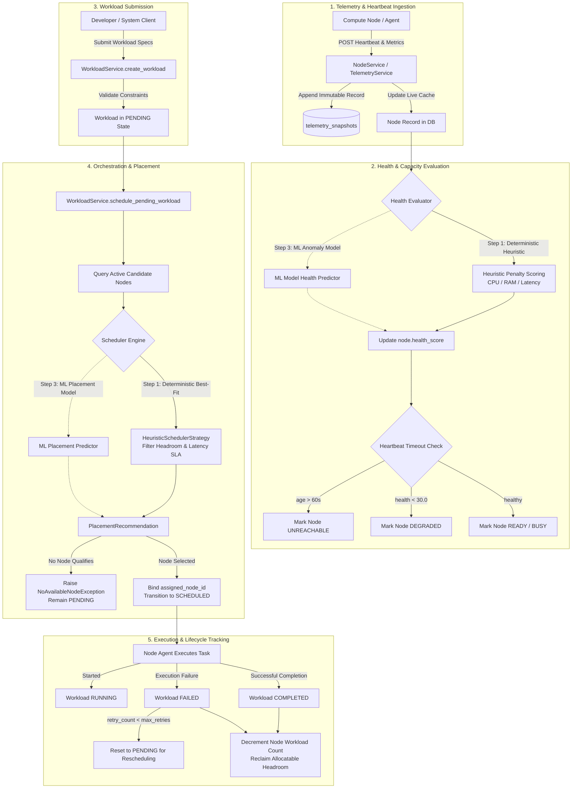
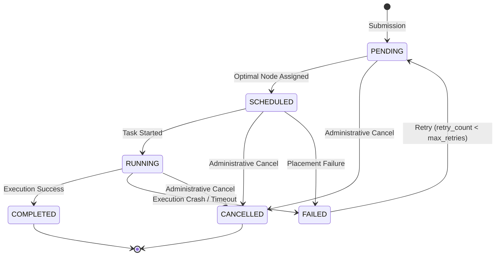
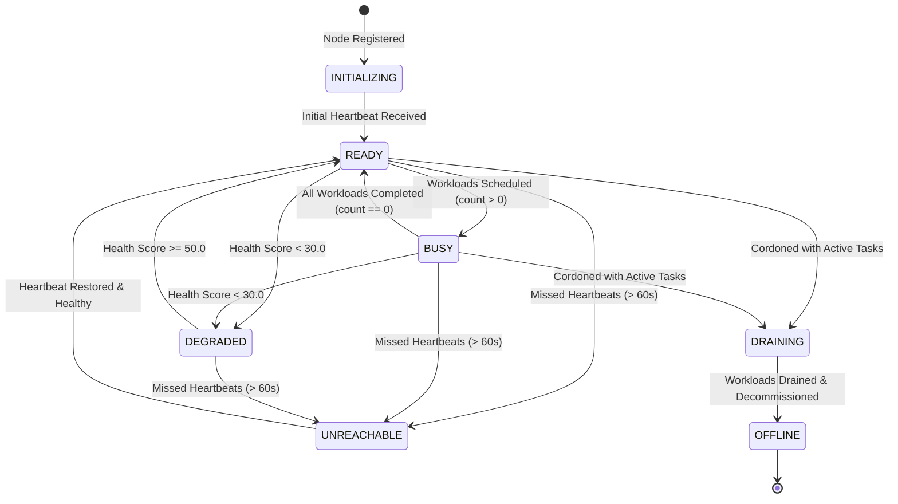
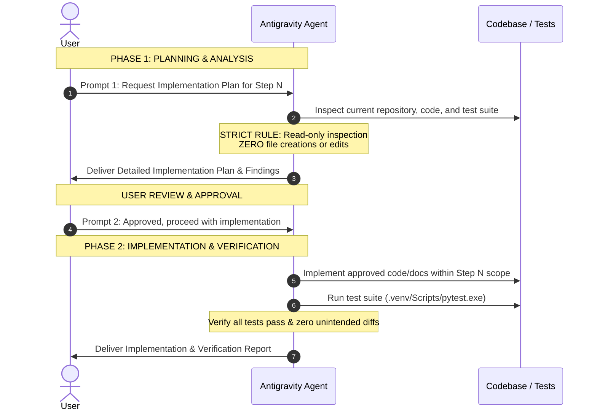

# System & Development Workflow (WORKFLOW)

```text
Project: INTELLICLUSTER
Document: WORKFLOW.md
Version: 1.0
Status: Approved Baseline
```

---

## 1. Overview & Operational Principles

This document establishes the dual workflow governing INTELLICLUSTER:
- **Part A: Runtime System Workflow**: The operational sequence through which clusters, compute nodes, telemetry metrics, and workloads move through ingestion, health evaluation, scheduling, and execution.
- **Part B: Development Workflow**: The immutable 10-step development sequence and the rigid two-prompt engineering discipline governing all code, test, and infrastructure modifications.

---

## Part A: Runtime System Workflow

The runtime pipeline coordinates telemetry ingestion, state evaluation, and workload placement across the cluster:



### Detailed Operational Stages

#### 1. Ingestion Stage
- Compute nodes submit periodic heartbeats containing telemetry data: CPU usage %, memory usage MB, disk usage GB, network TX/RX Mbps, network latency ms, and active socket connections.
- This ingestion occurs via `NodeService.process_heartbeat` or `TelemetryService.record_telemetry`, exposed over HTTP via `POST /api/v1/nodes/{node_id}/heartbeat`.
- Each report atomically appends an immutable record to the `telemetry_snapshots` table and updates the node's live cached counters and `last_heartbeat` timestamp.


#### 2. Health & Capacity Evaluation Stage
- Node health is evaluated immediately upon telemetry arrival.
- **Active Production Path**: Evaluated deterministically via `calculate_deterministic_health_score`. Points are deducted for high CPU, high memory, and network latency exceeding 20ms. If health falls below 30.0, the node status degrades automatically to `DEGRADED`.
- **ML Advisory Path**: Evaluated by ML services (`AI4IInferenceService`, `InfrastructureAnomalyService`) or classes implementing `BaseHealthPredictor` for contextual risk scoring.
- **Liveness Monitoring**: Background sweep calls `NodeService.mark_stale_nodes`. Any active node failing to report within `NODE_HEARTBEAT_TIMEOUT_SECONDS` (default: 60s) is marked `UNREACHABLE` and isolated from scheduling.


#### 3. Workload Submission Stage
- A compute task is registered via `WorkloadService.create_workload` with resource requirements (CPU cores requested, RAM MB requested, network bandwidth, latency tolerance SLA, execution duration estimate, and priority).
- The workload is persisted in the database in the `PENDING` state.

#### 4. Orchestration & Placement Stage
- Workload scheduling is triggered via `WorkloadService.schedule_pending_workload`.
- The service queries candidate nodes within the target cluster, excluding cordoned nodes (`is_cordoned=True`) and inactive nodes (`UNREACHABLE`, `DEGRADED`, `DRAINING`, `OFFLINE`).
- **Active Production Path**: `HeuristicSchedulerStrategy` filters nodes lacking allocatable CPU or RAM headroom and eliminates nodes breaching the workload's latency SLA. Eligible nodes are scored using a balanced fitness function rewarding low utilization, low latency, and high health.
- **ML Benchmark Path**: Model 5 (DQN) implements `BaseSchedulerPredictor` evaluating placement feature vectors for read-only shadow benchmarks without mutating cluster state.

- If no node qualifies, `NoAvailableNodeException` is raised, keeping the workload safely in the `PENDING` queue.
- If a node is selected, `assigned_node_id` is assigned, the node's `active_workload_count` is incremented, and status transitions to `SCHEDULED`.

#### 5. Execution & Lifecycle Tracking Stage
- The workload transitions to `RUNNING` when compute execution commences.
- Upon completion, status moves to `COMPLETED`, recording `completed_at` and releasing the node's active workload count.
- If execution fails, status moves to `FAILED`. If `retry_count < max_retries`, the workload is automatically reset to `PENDING` for rescheduled placement on an alternative node.

---

## 2. State Machine Specifications

### 2.1 Workload Lifecycle State Machine



### 2.2 Node Operational State Machine



---

## Part B: Development Workflow

Development of INTELLICLUSTER is strictly serialized across ten immutable steps. Skipping steps, combining steps, or executing future phases prematurely is **categorically forbidden**.

```text
┌────────────────────────────────────────────────────────┐
│             10-STEP DEVELOPMENT SEQUENCE               │
├───────────────────┬────────────────────────────────────┤
│ Step 1            │ Backend Foundation (Completed)     │
│ Step 2            │ REST API & HTTP Routers (Completed)│
│ Step 3            │ ML Model Training in Jupyter (Done)│
│ Step 4            │ ML Model Testing & Benchmarking (✓)│
│ Step 5            │ Frontend Application Building (✓)  │
│ Step 6 (Completed)│ Full Feature & Integration Testing │
│ Step 7 (Completed)│ UI Polish, CORS & Manifest Integrity│
│ Step 8 (Next)     │ Full Project Testing & Load Tests  │
│ Step 9 (Planned)  │ Cloud Deployment & AWS Verification│
│ Step 10 (Planned) │ Error Fixing & Final Stabilization │
└───────────────────┴────────────────────────────────────┘
```


---

## 3. Two-Prompt Engineering Cadence

Every development step follows a mandatory two-prompt protocol. No implementation may begin until the corresponding plan has been reviewed and approved by the user.



### Prompt 1: Plan & Analyze Only
- **Objective**: Thoroughly inspect the current repository, verify existing test suite status, analyze dependencies, and formulate a detailed implementation plan.
- **Absolute Restrictions**:
  - **DO NOT** create, modify, delete, or rename any project files.
  - **DO NOT** modify source code, tests, configurations, or database files.
  - **DO NOT** install dependencies.
- **Required Output**: Comprehensive assessment, component mappings, potential risks, and exact file changes proposed for Prompt 2.

### Prompt 2: Implement & Verify
- **Objective**: Implement precisely what was approved in Prompt 1.
- **Operational Rules**:
  - Restrict all modifications strictly to the deliverables of the active step.
  - Run the automated test suite (`.venv\Scripts\pytest.exe -v`) to confirm regressions have not been introduced.
  - Report all created or modified files, test results, and any ambiguities encountered.
  - **DO NOT** commence work on the subsequent step.
